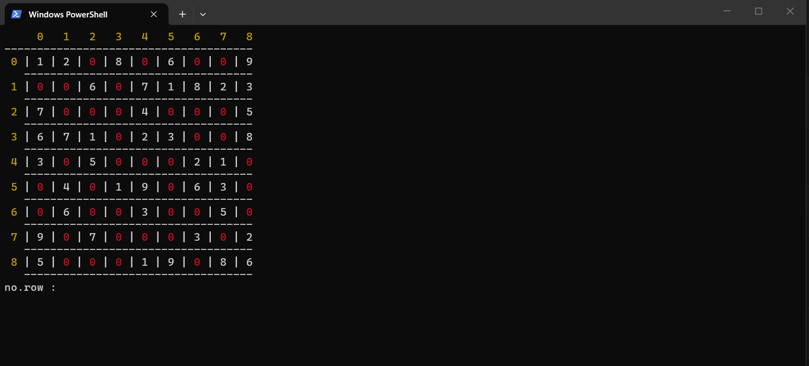
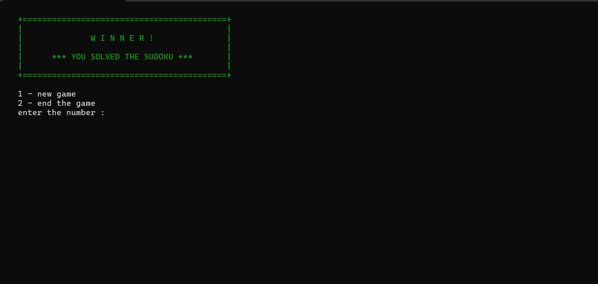

# Sudoku Game (C, Console)

A simple console Sudoku game written in C with one fixed level, colored output and sound effects.





## Download

Want to play without compiling? Download `sudoku-game-windows.zip` from the [Releases page](https://github.com/Mostafa2252/sudoku-game/releases), unzip it, and run `sudoku.exe`. Keep the `.wav` files in the same folder as the exe so the sounds work.

## Features

- 9x9 board with one fixed puzzle
- Colored console output (yellow labels, red empty cells, white clues)
- Input validation for row, column and value
- Locked clue cells that cannot be changed
- Sound effects for a correct move, a wrong move and a win
- Play again or exit after winning

## How to Play

Each turn the game asks for three numbers:

| Prompt | Meaning | Valid range |
|---|---|---|
| `no.row` | Row of the cell | 0 to 8 |
| `no.col` | Column of the cell | 0 to 8 |
| `value` | Digit to place | 1 to 9 |

- Red `0` cells are empty and can be filled.
- White digits are the given clues and cannot be changed.
- A move is rejected if the cell is already filled or the digit already exists in the same row or column.
- Fill every empty cell to win.

**Simplified rules:** moves are checked against the row and column only. The 3x3 box rule is not checked.

## Solution

Stuck? The solution to the built-in level is in [solution.jpg](solution.jpg). (Spoiler!)

## Requirements

- Windows (the game uses `windows.h`, `PlaySound` and `system("cls")`)
- GCC (MinGW-w64)

## Build and Run

```
gcc main.c sudoku.c -o sudoku -lwinmm
.\sudoku.exe
```

Run the game from the project folder so it can find `wrong.wav`, `correct.wav` and `win.wav`.

> **Note:** if your Windows user name or the compiler path contains a space, the linker may fail with `cannot find C:/Users/...`. Install MinGW-w64 in a path without spaces, for example `C:\mingw64`.

## Project Structure

```
sudoku-game/
├── main.c        # game loop, board data, sounds
├── sudoku.c      # input, drawing, move checking, win check
├── wrong.wav
├── correct.wav
├── win.wav
├── solution.jpg  # solution of the built-in level
├── screenshot.png
├── winner.png
└── README.md
```

## Possible Improvements

- Add the 3x3 box check
- Add more levels or a random puzzle generator
- Make it work on Linux (replace `PlaySound` and `system("cls")`)

## Author

Mostafa Mohamed Younis, Embedded software developer
